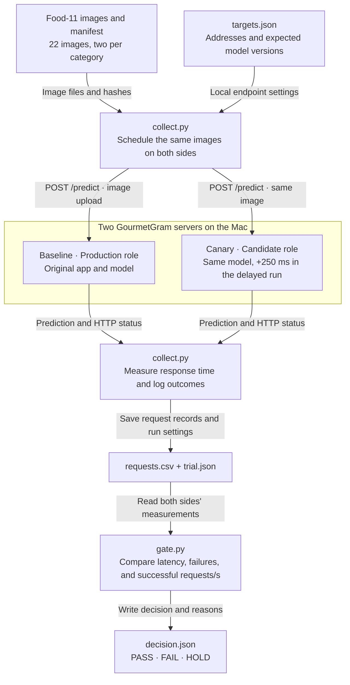

# First measured GourmetGram pilot

On November 25, 2026, two isolated copies of the original GourmetGram app served real Food-11 image requests on an Apple Silicon Mac. Both copies loaded the same upstream pretrained MobileNetV2 checkpoint. The Python collector sent identical image sequences at seven requests per second per endpoint for 30 seconds, after four seconds of warm-up.

| Local comparison | Baseline p95 | Canary p95 | Successful predictions | Gate |
|---|---:|---:|---:|---|
| Same application and model on both sides | 157.1 ms | 147.4 ms | 420/420 | PASS |
| Same setup with a 250 ms delay added before each Canary prediction | 74.6 ms | 340.3 ms | 420/420 | FAIL on p95 latency |

p95 is the time by which 95% of successful requests finished. Each row is one paired run with 210 requests per endpoint. Both ran at the planned rate and returned valid prediction responses. The delay ran inside the Canary server, before the original prediction handler. The collector recorded elapsed client time and the gate computed its decision directly from the CSV.

The baseline p95 moved between the two runs, so the validator compares each Canary with its own concurrent baseline. These runs establish that the collector and validator work with the original service and actual images. Estimates of gate reliability, resource cost, and comparison with manual promotion require the repeated [Chameleon case study](CASE_STUDY.md).

## How requests moved through the local pilot



Both servers received seven uploads per second for 30 seconds. In the delayed run, slot 0 used the same image and returned HTTP 200 on both sides. The baseline took 35 ms and Canary took 295 ms. The gate used the full request log to make its decision. See the [planned Chameleon integration](IMPLEMENTATION_PLAN.md) for how this flow fits into the existing pipeline.

## Inspect or replay the evidence

- [Food-11 manifest](evidence/local-pilot-2026-11-25/food11-pilot.json): 22 unique images from the validation split, two per category. The manifest identifies the versioned source archive, archive members, category IDs, sizes, and SHA-256 hashes. The sample was ranked deterministically with seed `5306`. The same sequence was used in both runs and on both endpoints.
- Same model: [Requests](evidence/local-pilot-2026-11-25/same-model/requests.csv) · [Trial settings](evidence/local-pilot-2026-11-25/same-model/trial.json) · [Decision](evidence/local-pilot-2026-11-25/same-model/decision.json)
- Delayed Canary: [Requests](evidence/local-pilot-2026-11-25/canary-plus-250ms/requests.csv) · [Trial settings](evidence/local-pilot-2026-11-25/canary-plus-250ms/trial.json) · [Decision](evidence/local-pilot-2026-11-25/canary-plus-250ms/decision.json)

Replay either decision from the repository root with Python 3.10 or later. The delay command exits with status 1 because the gate returned FAIL.

```sh
pilot=evidence/local-pilot-2026-11-25
python3 gate.py "$pilot/same-model/trial.json" "$pilot/same-model/requests.csv"
python3 gate.py "$pilot/canary-plus-250ms/trial.json" "$pilot/canary-plus-250ms/requests.csv"
```

## Reproduce the local setup

1. Use the [upstream workflow app at `d8e0199`](https://github.com/teaching-on-testbeds/gourmetgram/tree/d8e01993ef9a62e79039ed6162c104eb571a4205) and the [upstream checkpoint at `63fa165`](https://github.com/teaching-on-testbeds/gourmetgram-train/blob/63fa165b5ffc2cfe0e6f9ff86f2023c8d287f4b5/food11.pth). Copy the app to two temporary directories and place the checkpoint at `food11.pth` in each. Create `versions.txt` in each directory with the checkpoint's `sha256:` identifier from the trial settings. The evidence uses `local-app:` plus the source revision as the image identifier because it ran directly in Python.
2. The local setup used Python 3.13, PyTorch 2.7.1, torchvision 0.22.1, Flask 3.1.3, NumPy 2.5.5 and Pillow 13.0.0. Run `python pilot/serve.py /path/to/baseline-copy --port 18730` and `python pilot/serve.py /path/to/canary-copy --port 18731` in separate terminals using that environment. For the delay run, restart the copies and add `--delay-ms 250` to the Canary command. The wrapper binds to loopback and uses one PyTorch thread per copy.
3. Retrieve the named archive members from the [version 1 Food-11 mirror](https://www.kaggle.com/datasets/trolukovich/food11-image-dataset) and place them under an image root using `relative_path` from the manifest. `collect.py` verifies each hash and size. Keep the source archive and temporary uploads separate from the repository evidence. [Original dataset description](https://www.epfl.ch/labs/mmspg/downloads/food-image-datasets/)
4. Create `targets.json` as shown in the [README](README.md#collect-a-paired-run), using the loopback URLs and the exact model and image identifiers recorded in `trial.json`. Collect a new run with the following command, then replay it with the validator. Choose a fresh output directory for the next pair.

```sh
python3 collect.py targets.json evidence/local-pilot-2026-11-25/food11-pilot.json \
  /path/to/Food-11 runs/local-01 --source local --rate 7 --seconds 30 --warmup 4
python3 gate.py runs/local-01/trial.json runs/local-01/requests.csv
```
